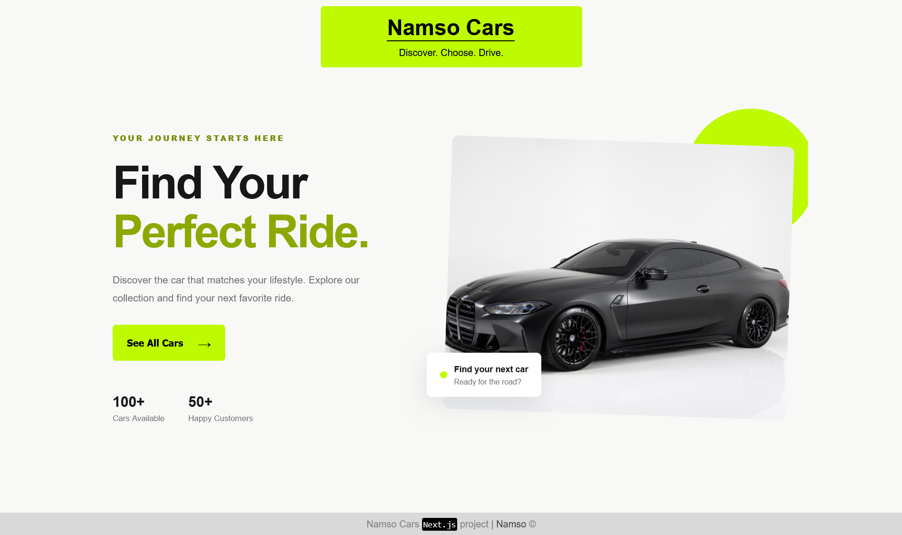
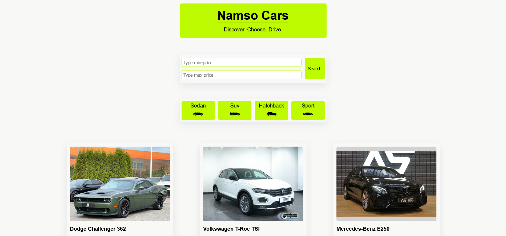
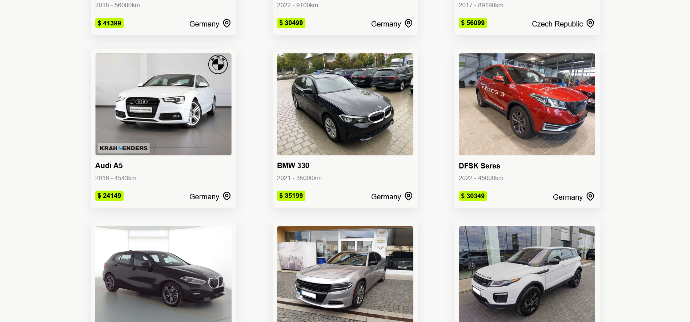
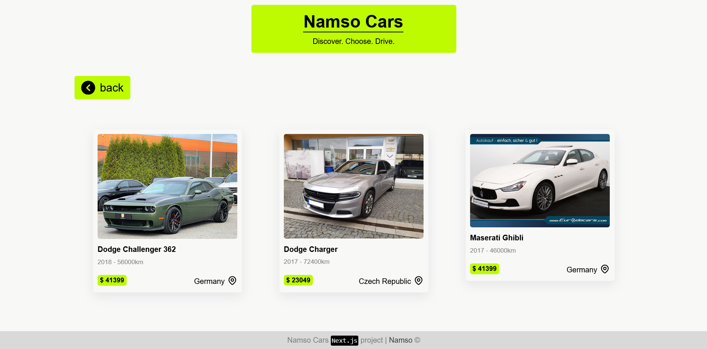
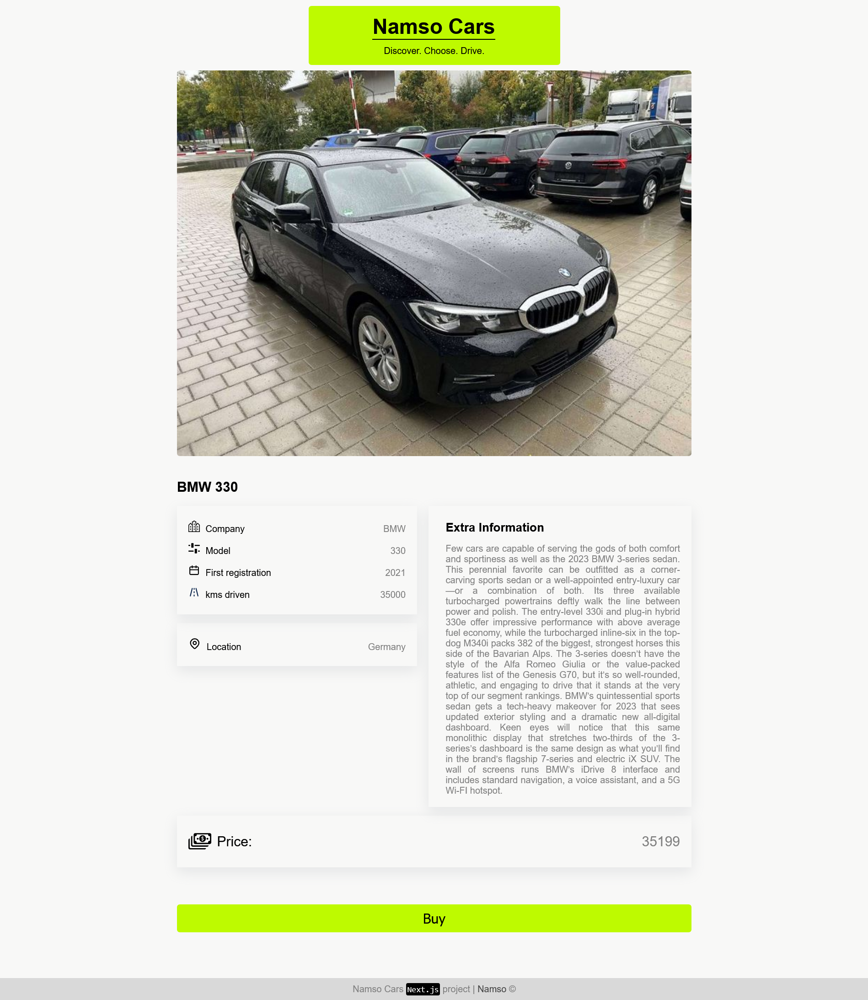
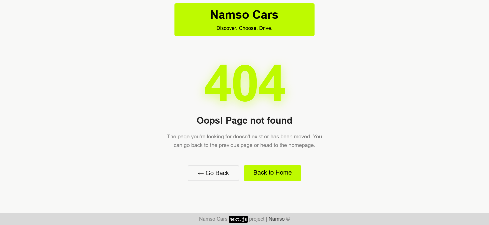

# Namso Cars 🚗

A modern, responsive car browsing application built with **Next.js** and **React**. Explore different car categories, view detailed vehicle information, and filter cars by price to find your car.

## Features

- **Landing Page:** A homepage introducing the application, with a button to explore all cars.
- **Car Listings:** Browse the available vehicles in a card-based layout.
- **Car Categories:** Explore cars by category, including SUVs, sedans, sports cars, and hatchbacks.
- **Car Details:** View detailed information about each vehicle, including its model, year, mileage, location, description, and price.
- **Price Filtering:** Filter cars using minimum and maximum price values.
- **Dynamic Routing:** Navigate between car listings, category pages, and individual vehicle details.
- **Custom 404 Page:** A dedicated page for handling unavailable routes and cars.
- **Responsive Styling:** CSS Modules for component-specific styling.

## Technologies Used

- **Next.js** — React framework for page routing and application structure.
- **React** — Building reusable UI components.
- **JavaScript** — Application logic and interactivity.
- **CSS Modules** — Component-scoped styling.
- **Next.js Router** — Navigation and dynamic route handling.

## Car Data

The application uses a local JavaScript data file (`data/carsData.js`) containing vehicle information.

Each car includes properties such as:

- `id` — Unique identifier.
- `name` — Car brand or name.
- `model` — Vehicle model.
- `year` — Registration or model year.
- `distance` — Mileage.
- `location` — Vehicle location.
- `price` — Listed price.
- `description` — Vehicle description.
- `image` — Path to the vehicle image.
- `category` — Vehicle category.

The available categories include **Sport**, **SUV**, **Sedan**, and **Hatchback**.

## Navigation

The application includes the following main pages and routes:

| Route                    | Description                     |
| ------------------------ | ------------------------------- |
| `/`                      | Landing page                    |
| `/cars`                  | Browse all cars                 |
| `/cars/[carId]`          | View details for a specific car |
| `/categories/[category]` | Browse cars by category         |
| `/cars/filter`           | Filter cars by price            |
| `/404`                   | Custom not-found page           |

## Screenshots

### Home Page

### Cars Page

### Categoried Cars

### Car Details

### 404 Page

